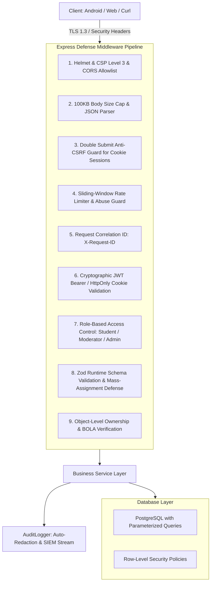

# Campus Connect — Backend Security Documentation & Verification

## 1. Architectural Overview & Defense in Depth

The Campus Connect backend is built using **Node.js**, **Express**, **TypeScript**, and **PostgreSQL**. The backend is designed from the ground up according to the **OWASP ASVS 5.0.0**, **OWASP API Security Top 10 (2023)**, and **NIST SSDF SP 800-218** guidelines.



---

## 2. Authentication & Identity Architecture

### 2.1 Password Hashing & Storage
- **Algorithm:** **Argon2id** (`argon2.argon2id`) via native `argon2` module.
- **Parameters:** Memory cost: 64 MB (65,536 KiB), Time cost: 3 iterations, Parallelism: 1 thread.
- **Zero Plaintext Storage:** Plaintext passwords are never persisted, cached, or written to logs.
- **Timing Attack Mitigation:** Constant-time hash comparisons and constant-time dummy hashing on user-not-found login attempts.

### 2.2 Token Lifecycle & Anti-Theft Protection
- **Access Tokens:** Signed JSON Web Tokens (`HS256`, 15-minute expiration) containing `sub` (User ID), `email`, `role`, and `mfaVerified`.
- **Refresh Tokens:** Cryptographically random 256-bit hexadecimal strings. The database stores only the single-use **SHA-256 hash**.
- **Refresh Token Rotation & Family Invalidation:**
  - Upon every refresh, the presented token is immediately revoked, and a new token is issued in the same family.
  - If a revoked token is presented (indicating theft or token replay), the server detects reuse and immediately **invalidates the entire token family**, terminating all sessions associated with that lineage.
- **Session Revocation:**
  - Password reset automatically increments `tokens_revoked_at` and revokes all active refresh tokens.
  - Account suspension immediately terminates active tokens and blocks new logins.

### 2.3 Anti-Enumeration Protection
- **Login:** Returns generic message: `"Invalid email or password."` for both nonexistent emails and wrong passwords.
- **Password Reset:** Always returns: `"If the provided email is registered in our system, a password reset link has been dispatched."` regardless of whether the account exists.

### 2.4 Multi-Factor Authentication (MFA)
- Standard **RFC 6238 Time-Based One-Time Password (TOTP)** implementation using Node.js `crypto` with constant-time verification.
- **Mandatory for Administrators:** Administrator accounts cannot perform administrative actions unless MFA is configured and verified (`mfaVerified: true`).

### 2.5 Web Cookie Security & Anti-CSRF
- Access tokens and refresh tokens are issued as `HttpOnly`, `Secure` (in production), and `SameSite=Strict` cookies.
- State-changing requests (`POST`, `PATCH`, `DELETE`) originating with ambient cookie authority require a synchronized `X-CSRF-Token` header matching the `cc_csrf_token` cookie.

---

## 3. Authorization & Privilege Separation

### 3.1 Role Hierarchy
- **Student (`student`):**
  - Submit single readings (`POST /readings`) and batch syncs (`POST /readings/batch`).
  - Access personal history (`GET /readings/mine`).
  - Manage own monitoring sessions (`POST /monitoring/sessions`, `POST /monitoring/sessions/:id/stop`).
  - Submit issue reports (`POST /issues`).
- **Moderator (`moderator`):**
  - Review and update issue reports (`GET /admin/issues`, `PATCH /admin/issues/:id`).
  - Create and update campus zones (`POST /admin/zones`, `PATCH /admin/zones/:id`).
  - Prohibited from: user account suspension, role changes, or viewing security audit logs.
- **Administrator (`administrator`):**
  - Manage user suspension and role assignments (`PATCH /admin/users/:id/suspend`, `PATCH /admin/users/:id/role`).
  - View full system security audit logs (`GET /admin/audit-logs`).
  - Requires active MFA. Prohibited from suspending or demoting self.

### 3.2 Broken Object-Level Authorization (BOLA) Defense
- Resources cannot be accessed or manipulated by guessing IDs:
  - `GET /readings/mine` binds strictly to the authenticated `user.sub` token subject.
  - `POST /monitoring/sessions/:sessionId/stop` validates that the session belongs to the requesting student. Attempts by Student A to stop Student B's session return HTTP `403 Forbidden` and log an `AUTHZ_FAILURE` audit event.

---

## 4. API & Data Protection

### 4.1 Strict Schema Validation (Zod)
- All request bodies, query parameters, and route parameters are validated against strict Zod schemas (`.strict()`).
- **Mass Assignment Defense:** Unmapped or unexpected properties are stripped or rejected.
- **ReDoS Defense:** String fields enforce length limits (`max(32)` or `max(100)`) and linear regex patterns (`/^[\w\.\-]+$/`).
- **Size Limits:** Express body parsers enforce a hard 100KB ceiling, rejecting oversized payloads with HTTP `413 Payload Too Large`.

### 4.2 Privacy Invariants & Diagnostic Neutrality
- **Hardware Identifier Proscription:** Ingestion schemas permanently reject fields matching `imei`, `imsi`, `mac`, `sim`, `phoneNumber`, `latitude`, `longitude`, `gps`.
- **Differential Privacy & K-Anonymity:** Zone analytics and heatmaps return status `INSUFFICIENT_DATA` unless at least **5 readings across at least 3 distinct devices** exist in the time window.
- **Jammer Neutrality:** UI copy, API messages, and analytics assert only physical observations (throughput, latency, signal in dBm). The system never diagnoses or labels radio jammers.

### 4.3 Database Security & Migrations
- **Database Engine:** PostgreSQL.
- **Parameterized Queries:** All SQL queries use positional parameters (`$1, $2`), preventing SQL injection.
- **Row-Level Security (RLS):** SQL migration `002_row_level_security.sql` establishes database-enforced row isolation policies.
- **Least-Privilege Roles:** Documentation and `.env.example` configure separate `cc_api_user` (DML only) and `cc_migration_user` (DDL only) roles.

---

## 5. Security Audit Logging

Structured JSON audit logs capture:
- User registration, login success, login failure, and token refresh.
- MFA enablement and challenge failures.
- Administrative zone changes, issue updates, user suspensions, and role changes.
- Authorization failures (`AUTHZ_FAILURE`) and rate-limit violations (`RATE_LIMIT_EXCEEDED`).
- **Automatic Redaction:** Sensitive attributes (`password`, `password_hash`, `token`, `access_token`, `refresh_token`, `authorization`, `mfa_secret`, `cookie`) are recursively masked as `[REDACTED]`.

---

## 6. Automated Security Test Verification Evidence

The automated security test suite covers 29 comprehensive test cases across 6 test suites using the Node.js test runner (`tsx --test`):

```text
▶ Security Audit Logging & Redaction Tests
  ✔ AuditLogger.redact properly redacts sensitive passwords, tokens, and authorization headers
  ✔ Administrative actions create immutable audit logs queryable by administrator
✔ Security Audit Logging & Redaction Tests (2/2 passed)

▶ Authentication & Session Security Tests
  ✔ Registration hashes password with Argon2id and never stores plaintext
  ✔ Password policy enforces NIST guidelines (rejects weak passwords)
  ✔ Login with valid credentials succeeds and issues HttpOnly cookies
  ✔ Login failure returns generic anti-enumeration response and logs failure
  ✔ Authentication rate limiting triggers HTTP 429 after 5 failed attempts
  ✔ Refresh token rotation issues new tokens and revokes previous token
  ✔ Refresh token reuse attack invalidates entire family (compromise detection)
  ✔ Password reset request is anti-enumerative and single-use token invalidates sessions
  ✔ Account suspension blocks login and rejects existing tokens
  ✔ Administrator account requires MFA setup and TOTP verification
✔ Authentication & Session Security Tests (10/10 passed)

▶ Authorization & Access Control Security Tests
  ✔ BFLA: Student cannot access administrative endpoints (returns 403 Forbidden)
  ✔ BFLA: Moderator can manage zones and issues but CANNOT suspend users or view audit logs
  ✔ BOLA: Student A cannot stop Student B monitoring session
  ✔ BOLA: Student calling /readings/mine receives strictly own reading history
✔ Authorization & Access Control Security Tests (4/4 passed)

▶ Rate Limiting & Abuse Prevention Tests
  ✔ Public endpoints return standard rate limit headers
  ✔ Exceeding rate limit returns 429 and Retry-After header
✔ Rate Limiting & Abuse Prevention Tests (2/2 passed)

▶ Readings Ingestion & Analytics Privacy Tests
  ✔ Valid manual reading submission succeeds and persists data
  ✔ Idempotent submission: submitting identical readingId returns duplicate: true without error
  ✔ Privacy Invariant: Prohibits collection of hardware identifiers (IMEI, IMSI) and GPS
  ✔ Validation bounds: Rejects negative speeds, negative latency, and stale timestamps
  ✔ Batch upload respects 50 items maximum limit and handles duplicates gracefully
  ✔ Differential privacy & k-anonymity: Zone status is INSUFFICIENT_DATA until k >= 5 across >= 3 devices
  ✔ Diagnostic neutrality: Response copy never claims jammer or interference attacks
✔ Readings Ingestion & Analytics Privacy Tests (7/7 passed)

▶ Validation, SQLi & ReDoS Defense Tests
  ✔ Mass assignment defense: Extra/unauthorized attributes are stripped by schema validation
  ✔ SQL injection resilience: SQL injection payloads in query and path params are safely handled
  ✔ ReDoS resilience: Extremely long regex strings are rejected within milliseconds
  ✔ Request body size limit enforces 100KB ceiling (rejects oversized payloads with 413)
✔ Validation, SQLi & ReDoS Defense Tests (4/4 passed)

Total: 29 passed, 0 failed, 0 skipped
```
