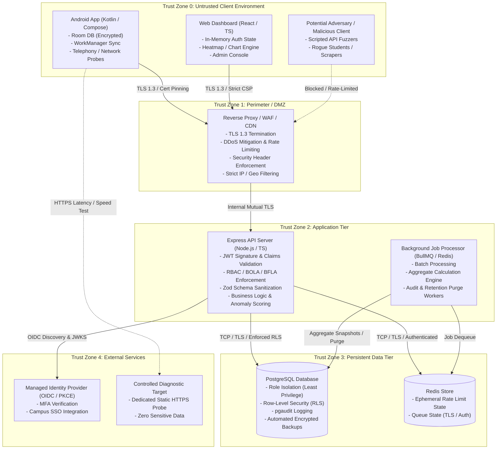
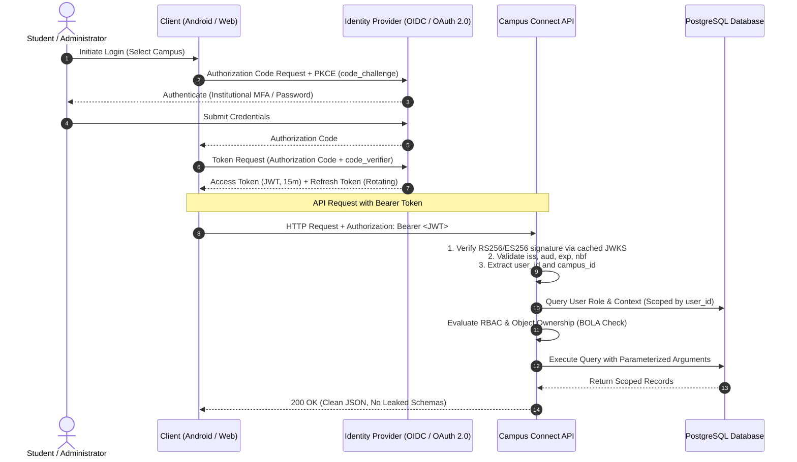
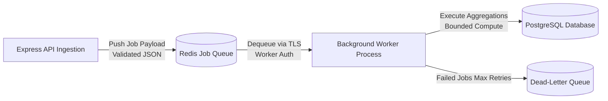
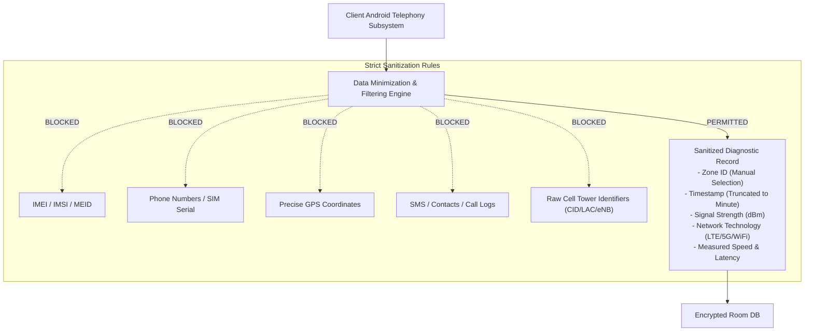

# Campus Connect — Security Architecture

## 1. Executive Summary & Security Philosophy

Campus Connect is an intelligence platform designed to observe, record, aggregate, and visualize mobile-network connectivity conditions across broad college campus zones. Operating in a shared, multi-tenant university environment presents unique security and privacy challenges: untrusted and heterogeneous student mobile devices, adversarial or prankster students, sensitive personal mobility patterns, and multi-tier administrative workflows.

This architecture enforces ten non-negotiable security and privacy principles:
1. **Defence in Depth:** No single layer (e.g., perimeter firewall or API gateway) bears sole responsibility for security. Security controls exist at the client runtime, network boundary, reverse proxy, application middleware, database engine, and physical/cloud infrastructure.
2. **Least Privilege Everywhere:** Every process, service account, database role, and user token is provisioned with the absolute minimum set of capabilities required to fulfill its function.
3. **Data Minimization & Zero PII Collection:** The system strictly rejects collection of persistent hardware identifiers (IMEI, IMSI, MAC addresses, SIM serials), subscriber identifiers (phone numbers), communication records (SMS, contacts, call logs), browsing history, and precise GPS telemetry. Location is abstracted to administrative campus zones.
4. **Secure Every API and Database Operation:** All endpoints require strict cryptographic authentication and fine-grained authorization checks. All database interactions utilize parameterized statements and enforced Row-Level Security (RLS) policies.
5. **Strict Role & Privilege Separation:** The system enforces strict separation between four user personas: `student`, `campus_viewer`, `campus_admin`, and `system_admin`. Privilege escalation across functional tiers is cryptographically and logically prohibited.
6. **Prevention of Unauthorized Data Access:** Raw telemetry records and individual contributor histories are strictly isolated. Public dashboards and aggregate analytics endpoints expose only de-identified, k-anonymized aggregate snapshots.
7. **Proactive Resistance to Common Attacks:** The system is explicitly hardened against the OWASP Top 10 (Web), OWASP API Security Top 10, and OWASP Mobile Top 10/MASVS vulnerabilities.
8. **Secure Failure & Information Leak Prevention:** The platform fails closed. Internal exceptions, stack traces, database schemas, or infrastructure topologies are never leaked to external clients. Client error responses adhere to standardized, opaque machine-readable error codes.
9. **Testable & Traceable Security Controls:** Every architectural control is mapped to formal standards (OWASP ASVS 5.0.0, OWASP MASVS v2.0, OWASP API Security Top 10, and NIST SSDF SP 800-218) and accompanied by automated verification test cases.
10. **Scientific & Diagnostic Neutrality:** The system documents empirical measurements (signal strength, latency, throughput, reachability) and refuses to infer or attribute radio interference or "jammers." The architecture explicitly prevents the platform from being weaponized to publish false or unverified security alerts.

> [!IMPORTANT]
> **No System is Perfectly Secure:** Security is a continuous process of risk management, defensive engineering, and auditability. This architecture aims to dramatically raise the economic and technical cost of compromise while ensuring rapid containment and recovery if an incident occurs.

---

## 2. End-to-End System Trust Boundaries & Data Flow

The Campus Connect deployment topology partitions the system into distinct trust zones separated by hardened network and cryptographic boundaries.



### Trust Boundary Analysis

| Boundary | Interfacing Components | Threats at Boundary | Enforcement Mechanisms |
|---|---|---|---|
| **TB-1: Client to DMZ** | Android App / Web Browser → Reverse Proxy (WAF/CDN) | Man-in-the-Middle (MitM), TLS downgrade, volumetric DDoS, SYN floods, credential stuffing. | Strict TLS 1.3; TLS cipher suite restriction (`TLS_AES_256_GCM_SHA384`, `TLS_CHACHA20_POLY1305_SHA256`); HSTS preloading; Network Security Config certificate pinning on Android; Edge rate limiting. |
| **TB-2: DMZ to API Gateway** | Reverse Proxy → Node.js Express API | IP spoofing, header tampering, malformed HTTP request smuggling. | Reverse proxy rewrites and sanitizes incoming headers (`X-Forwarded-For`, `X-Request-ID`); Express configures trusted proxy CIDR blocks strictly; drops unlisted or dangerous headers. |
| **TB-3: API to Data Tier** | Express API → PostgreSQL & Redis | SQL injection, privilege escalation, credential compromise, data leakage across tenant/campus boundaries. | Parameterized queries exclusively; dedicated unprivileged DB user (`cc_api_user`); PostgreSQL Row-Level Security (RLS); DB TLS connection (`sslmode=verify-full`); Redis password authentication with dedicated Redis ACLs. |
| **TB-4: Worker to DB** | Background Workers → PostgreSQL | Worker exploitation leading to unauthorized data corruption or full DB wipe. | Worker operates under dedicated DB user (`cc_worker_user`) restricted to reading raw readings and inserting/updating aggregate snapshots; blocked from altering user or permission tables. |
| **TB-5: Client to Diagnostics** | Android App → Diagnostic Probe | SSRF, data exfiltration through measurement endpoints, traffic manipulation. | The diagnostic target is a strictly controlled, dedicated, static HTTPS endpoint serving fixed-size test assets with no backend processing; no user-supplied URLs are ever accepted for diagnostic tests. |

---

## 3. Authentication & Authorization Architecture

### 3.1 Identity & Token Architecture
Campus Connect relies on OpenID Connect (OIDC) with OAuth 2.0 PKCE (Proof Key for Code Exchange) backed by a managed identity provider (e.g., Supabase Auth, Keycloak, or institutional Shibboleth/Azure AD).



#### Token Security Specifications:
1. **Algorithm Enforcement:** The API accepts only asymmetric signatures (`RS256` or `ES256`). Symmetric algorithms (`HS256`) and the `none` algorithm are rejected at startup.
2. **Short-Lived Access Tokens:** Maximum validity of **15 minutes**.
3. **Rotating Refresh Tokens:** Single-use refresh tokens stored in platform-secure storage. Refresh token reuse triggers immediate invalidation of the entire token family.
4. **Token Content:** JWT claims are strictly minimized:
   ```json
   {
     "iss": "https://auth.campusconnect.edu",
     "sub": "3fa85f64-5717-4562-b3fc-2c963f66afa6",
     "aud": "campus-connect-api",
     "exp": 1732356900,
     "nbf": 1732356000,
     "campus_id": "a1b2c3d4-e5f6-7a8b-9c0d-1e2f3a4b5c6d"
   }
   ```
   *Roles and fine-grained permissions are looked up server-side in the `users` table or signed as claims verified against a server-side revocation list.*

### 3.2 Role-Based & Attribute-Based Access Control (RBAC/ABAC)

The system defines four distinct, non-overlapping roles:

```text
+---------------------------------------------------------------------------------------+
|                                ROLE PRIVILEGE MATRIX                                  |
+-------------------+---------------+-----------------+----------------+----------------+
| Operation / Asset | Student       | Campus Viewer   | Campus Admin   | System Admin   |
+-------------------+---------------+-----------------+----------------+----------------+
| Submit Reading    | YES (Own ID)  | NO              | NO             | NO             |
| View Own Readings | YES (Own only)| NO              | NO             | AUDITED SUPPORT|
| View Raw Readings | NO            | NO              | NO             | RESTRICTED AUD |
| View Heatmap/Aggs | YES           | YES             | YES            | YES            |
| Submit Issue      | YES (Own ID)  | NO              | NO             | NO             |
| Review/Close Issue| NO            | NO              | YES (Campus)   | YES            |
| Create/Edit Zones | NO            | NO              | YES (Campus)   | YES            |
| Start Monitoring  | YES (Own ID)  | NO              | NO             | NO             |
| Stop Monitoring   | YES (Owner)   | NO              | NO             | YES (Emergency)|
| Manage Roles      | NO            | NO              | NO             | YES            |
| Purge / Retention | NO            | NO              | NO             | YES            |
| Export Aggregate  | NO            | YES (Approved)  | YES            | YES            |
+-------------------+---------------+-----------------+----------------+----------------+
```

#### Authorization Invariant Checks:
- **BOLA / IDOR Prevention:** Whenever a student accesses `/readings/mine` or stops a monitoring session `/monitoring/sessions/:id/stop`, the query must strictly bind to the authenticated `sub` (user ID) from the verified token:
  ```sql
  UPDATE monitoring_sessions 
  SET status = 'STOPPED', ended_at = NOW() 
  WHERE id = $1 AND user_id = $2 AND status = 'ACTIVE';
  ```
- **BFLA Prevention:** Administrative routes (`/admin/*`) sit behind a mandatory middleware chain:
  `requireAuth -> requireRole(['campus_admin', 'system_admin']) -> verifyCampusScope`.

---

## 4. Mobile Client Security Architecture (Android)

The Android application (Kotlin, Jetpack Compose, MVVM) operates in an untrusted host environment. Its security posture adheres strictly to OWASP MASVS v2.0 (Level L1 + Privacy Enhancements).

### 4.1 Local Storage Security (OWASP MASVS-STORAGE)
- **Room Database Encryption:** Local SQLite persistence is encrypted at rest using **SQLCipher for Android**. 
- **Key Management:** The database encryption key is generated at initial app startup using a cryptographically secure random number generator (`SecureRandom`) and stored in the **Android Keystore System** using an AES-256-GCM `MasterKey` (`EncryptedSharedPreferences`).
- **No Sensitive Telemetry in Logs:** Android `Logcat` calls are stripped in release builds using R8 ProGuard rules. Sensitive fields (e.g., tokens, reading payloads) are never printed.
- **Cache Eviction:** Diagnostic measurements marked as `UPLOADED` are deleted from Room after server confirmation and a 24-hour verification window to minimize local data exposure if the device is lost or stolen.

### 4.2 Transport Security & Certificate Pinning (OWASP MASVS-NETWORK)
The application enforces strict network security via `res/xml/network_security_config.xml`:
```xml
<?xml version="1.0" encoding="utf-8"?>
<network-security-config>
    <base-config cleartextTrafficPermitted="false">
        <trust-anchors>
            <certificates src="system" />
        </trust-anchors>
    </base-config>
    <domain-config cleartextTrafficPermitted="false">
        <domain includeSubdomains="true">api.campusconnect.edu</domain>
        <!-- Dynamic SPKI Public Key Pinning with Disaster Recovery Pins -->
        <pin-set expiration="2027-01-01">
            <pin digest="SHA-256">47DEQpj8HBSa+/TImW+5JCeuQeRkm5NMpJWZG3hSuFU=</pin> <!-- Primary Leaf -->
            <pin digest="SHA-256">k2ErWTSp4jxQKsKT6ggDxYriyqnIqWq+PO532uNe27i=</pin> <!-- Backup Intermediate -->
        </pin-set>
    </domain-config>
</network-security-config>
```
- **Captive Portal Handling:** When connected to an unauthenticated campus Wi-Fi captive portal, network requests fail closed rather than falling back to cleartext HTTP. The app detects captive portal state via `NetworkCapabilities.NET_CAPABILITY_CAPTIVE_PORTAL` and pauses sync gracefully without degrading cryptographic controls.

### 4.3 Code Hardening & Integrity Protection (OWASP MASVS-CODE)
- **R8 / ProGuard Obfuscation:** Shrinking, code obfuscation, and optimization are active for all release builds. Class names, field names, and internal method signatures are obfuscated.
- **Integrity Validation:** Release APKs and App Bundles are signed using APK Signature Scheme v3. Play Integrity API verification is supported optionally in institutional enterprise pilots to detect modified or repackaged binaries.
- **Component Security:** All Android activities, services, broadcast receivers, and content providers in `AndroidManifest.xml` are explicitly marked with `android:exported="false"` unless explicitly required as an OS entry point (e.g., MainActivity launcher).

### 4.4 Diagnostic & Privacy Boundary on Device
- **Permission Minimization:** Android permissions are limited to:
  - `android.permission.INTERNET` (Normal permission)
  - `android.permission.ACCESS_NETWORK_STATE` (Normal permission)
  - `android.permission.READ_PHONE_STATE` (Runtime permission: requested *only* if cellular radio context is needed, and gracefully degraded if denied).
- **Prohibited Permissions:** The app manifest permanently prohibits:
  - `ACCESS_FINE_LOCATION`, `ACCESS_COARSE_LOCATION`, `ACCESS_BACKGROUND_LOCATION`
  - `READ_PRIVILEGED_PHONE_STATE`
  - `READ_SMS`, `RECEIVE_SMS`, `READ_CALL_LOG`, `READ_CONTACTS`
  - `READ_EXTERNAL_STORAGE`, `WRITE_EXTERNAL_STORAGE`
- **Location Decoupling:** The device never calls Android Location Services (`LocationManager`, FusedLocationProvider). Zone attribution is performed purely via manual user UI selection from a server-provided list of broad zones.
- **Optional Monitoring Session Lifecycle:**
  - Starts *only* upon deliberate user action in the UI.
  - Accompanied by a non-dismissible foreground service notification (`FOREGROUND_SERVICE_TYPE_DATA_SYNC` / `SPECIAL_USE`) clearly stating: *"Campus Connect diagnostic monitoring active — Zone: Library — Tap to Stop"*.
  - Enforces an immutable countdown timer (maximum 30 minutes). Upon timer expiry or user tap on "Stop", all callbacks (`ConnectivityManager.NetworkCallback`, `TelephonyCallback`) are instantly unregistered and the foreground service terminates.

---

## 5. Web Client Security Architecture (React Dashboard)

The Web Dashboard (React, TypeScript, Tailwind CSS) serves campus administrators and viewers, presenting aggregated heatmaps and moderation tools.

### 5.1 Content Security Policy (CSP Level 3) & HTTP Security Headers
The web frontend is served with strict, non-negotiable security headers injected by the reverse proxy:
```http
Content-Security-Policy: default-src 'none'; script-src 'self'; style-src 'self' 'unsafe-inline'; img-src 'self' data: https://*.tile.openstreetmap.org; connect-src 'self' https://api.campusconnect.edu; font-src 'self'; object-src 'none'; media-src 'none'; frame-ancestors 'none'; base-uri 'self'; form-action 'self'; block-all-mixed-content; upgrade-insecure-requests;
Strict-Transport-Security: max-age=63072000; includeSubDomains; preload
X-Content-Type-Options: nosniff
X-Frame-Options: DENY
Referrer-Policy: strict-origin-when-cross-origin
Permissions-Policy: camera=(), microphone=(), geolocation=(), payment=(), usb=(), screen-wake-lock=()
Cross-Origin-Opener-Policy: same-origin
Cross-Origin-Embedder-Policy: require-corp
Cross-Origin-Resource-Policy: same-origin
```

### 5.2 XSS & Injection Prevention
- **Framework Auto-Escaping:** React’s JSX engine escapes variable interpolations by default.
- **Zero Dangerous APIs:** The codebase prohibits `dangerouslySetInnerHTML`, `eval()`, `Function()`, and `document.write`.
- **Sanitization of User Inputs:** In issue moderation panels where student descriptions are rendered, inputs are sanitized through DOMPurify with strict HTML-entity stripping before rendering.

### 5.3 Web Session & Anti-CSRF Architecture
- **Token Storage Strategy:** Access tokens are maintained in **in-memory JavaScript variables** (closure scope), never in `localStorage` or `sessionStorage` (preventing token theft via XSS).
- **Refresh Flow:** Token renewal uses an `HttpOnly`, `Secure`, `SameSite=Strict` cookie dedicated exclusively to the `/auth/refresh` endpoint.
- **Anti-CSRF Protection:** State-changing requests (`POST`, `PATCH`, `DELETE`) require a cryptographic Anti-CSRF Token transmitted via a custom header (`X-CSRF-Token`), validated using the Double Submit Cookie pattern or synchronized server token.

---

## 6. Backend API & Server Security Architecture (Node.js / Express)

### 6.1 Defense-in-Depth Middleware Pipeline

Every HTTP request traverses a rigid, sequential middleware security pipeline:

```text
Incoming HTTP Request
   │
   ▼
[1. Reverse Proxy Trust & IP Normalization] ──► Validates trusted proxy CIDRs; extracts client IP.
   │
   ▼
[2. Security Headers (Helmet)] ───────────────► Sets CSP, HSTS, Sniff, Referrer headers.
   │
   ▼
[3. CORS Guard] ──────────────────────────────► Validates Origin header against whitelist; blocks rogue origins.
   │
   ▼
[4. Rate Limiting (Redis Leaky Bucket)] ──────► Enforces global, per-IP, and per-user consumption quotas.
   │
   ▼
[5. Payload Size & Content-Type Gate] ────────► Rejects bodies >100KB; rejects non-application/json.
   │
   ▼
[6. Correlation Context (X-Request-ID)] ─────► Binds unique UUID to request context using AsyncLocalStorage.
   │
   ▼
[7. Cryptographic JWT Authentication] ────────► Validates token signature, expiration, and issuer.
   │
   ▼
[8. Role & Permission Authorization] ────────► Enforces RBAC permissions for the target endpoint.
   │
   ▼
[9. Schema Validation & Sanitization] ────────► Zod runtime validation; strips unmapped keys; validates bounds.
   │
   ▼
[10. Business Logic & BOLA Validation] ───────► Verifies user ownership and active campus/zone scope.
   │
   ▼
[11. Parameterized Database Execution] ──────► Executes SQL query with bound parameters.
   │
   ▼
[12. Secure Error Handler] ───────────────────► Catches all errors; logs full trace internally; returns opaque JSON.
```

### 6.2 Implementation Details of Key Security Middleware

```typescript
// Example: Strict Runtime Schema Validation for Ingestion (Zod)
import { z } from 'zod';

export const ReadingIngestionSchema = z.object({
  readingId: z.string().uuid(),
  zoneId: z.string().uuid(),
  networkType: z.enum(['WIFI', 'MOBILE', 'OTHER', 'UNKNOWN']),
  downloadMbps: z.number().min(0).max(10000).nullable().optional(),
  latencyMs: z.number().min(0).max(60000).nullable().optional(),
  measurementSource: z.enum(['APP_TEST', 'MANUAL', 'IMPORTED', 'DEMO']),
  clientMeasuredAt: z.string().datetime().refine((val) => {
    const measured = new Date(val).getTime();
    const now = Date.now();
    // Allow up to 7 days in the past (offline queue) and 5 minutes in the future (clock skew)
    return measured <= now + 300000 && measured >= now - (7 * 86400000);
  }, { message: "Measurement timestamp outside permissible offline window" }),
  appVersion: z.string().max(32).regex(/^[\w\.\-]+$/).optional(),
  platformVersion: z.string().max(32).regex(/^[\w\.\-\s]+$/).optional(),
  networkContext: z.object({
    serviceState: z.enum(['IN_SERVICE', 'OUT_OF_SERVICE', 'EMERGENCY_ONLY', 'POWER_OFF']).nullable().optional(),
    signalDbm: z.number().int().min(-150).max(0).nullable().optional(),
    radioTechnology: z.string().max(16).regex(/^[\w\-]+$/).nullable().optional(),
    carrierLabel: z.string().max(32).regex(/^[\w\s\.\-]+$/).nullable().optional(),
    activeTransport: z.enum(['WIFI', 'CELLULAR', 'ETHERNET', 'BLUETOOTH', 'UNKNOWN']).nullable().optional(),
    internetCapability: z.boolean().nullable().optional(),
    internetValidated: z.boolean().nullable().optional(),
    dataFreshness: z.enum(['FRESH', 'CACHED', 'UNKNOWN']).nullable().optional()
  }).optional()
}).strict(); // Prohibit unknown fields (BOPL defense)
```

### 6.3 Rate Limiting & Resource Exhaustion Defense

Tiered rate limits are enforced via Redis:
- **Global Public Endpoints (`/health`, `/campuses`):** 100 requests/minute per IP.
- **Readings Submission (`POST /readings`):** 10 requests/minute per authenticated student.
- **Batch Submission (`POST /readings/batch`):** 5 requests/minute per authenticated student (maximum 50 readings per batch).
- **Issue Submission (`POST /issues`):** 3 requests/hour per student.
- **Administrative Endpoints (`/admin/*`):** 60 requests/minute per administrator.

### 6.4 Secure Error Handling & Information Leakage Prevention
```typescript
// Centralized Express Error Handling Middleware
export const secureErrorHandler = (err: any, req: Request, res: Response, next: NextFunction) => {
  const requestId = req.headers['x-request-id'] || 'unknown';
  
  // Structured logging to internal collector (redacted)
  logger.error('Unhandled request exception', {
    requestId,
    errorName: err.name,
    errorMessage: err.message,
    stack: process.env.NODE_ENV === 'production' ? undefined : err.stack,
    path: req.path,
    method: req.method,
    ip: req.ip,
    userId: req.user?.id
  });

  // Client response is completely sanitized
  if (err instanceof z.ZodError) {
    return res.status(400).json({
      error: {
        code: 'VALIDATION_ERROR',
        message: 'The submitted request payload failed validation criteria.',
        requestId,
        details: err.errors.map(e => ({ field: e.path.join('.'), issue: e.message }))
      }
    });
  }

  // Generic 500 failsafe
  return res.status(500).json({
    error: {
      code: 'INTERNAL_SERVER_ERROR',
      message: 'An unexpected error occurred while processing your request.',
      requestId
    }
  });
};
```

---

## 7. Background Processing & Queue Security

Background workers process batch synchronization, recompute aggregate snapshots, and execute retention deletion jobs.



### Worker Hardening Rules:
1. **Isolated Execution Context:** Workers execute in a dedicated container or process space distinct from the public-facing API web server.
2. **Strict Queue ACLs:** Workers connect to Redis using dedicated ACL credentials restricted solely to BullMQ queue keys (`cc_queue:*`).
3. **Payload Sanitization:** Workers never deserialize arbitrary binary code (e.g., prohibiting `node:serialize` or unsafe YAML parsers). Job payloads are strictly validated JSON.
4. **Idempotency & Deduplication:** Every aggregation job uses a deterministic idempotency key derived from `(zone_id, metric, window_start, window_end)`.
5. **Dead-Letter Queue (DLQ) & Alerting:** Jobs that fail after 3 exponential backoff retries are moved to a Dead-Letter Queue. DLQ depth is actively monitored; alerts trigger when DLQ depth exceeds zero.

---

## 8. Database Security & Storage Architecture (PostgreSQL)

### 8.1 Least-Privilege Database Role Separation

The PostgreSQL database enforces segregation of duties via role-based database privileges:

```sql
-- Revoke default public schema privileges
REVOKE ALL ON SCHEMA public FROM PUBLIC;

-- 1. Migration Role (Used only during deployment CI/CD)
CREATE ROLE cc_migration_user WITH LOGIN PASSWORD 'vault_managed_migration_pass';
GRANT ALL ON SCHEMA public TO cc_migration_user;

-- 2. API Application Role (Used by Express Backend)
CREATE ROLE cc_api_user WITH LOGIN PASSWORD 'vault_managed_api_pass';
GRANT USAGE ON SCHEMA public TO cc_api_user;
GRANT SELECT, INSERT, UPDATE ON TABLE campuses, buildings, zones, users, readings, 
    reading_network_context, monitoring_sessions, connectivity_tests, issue_reports TO cc_api_user;
GRANT SELECT ON TABLE zone_aggregates TO cc_api_user;
-- cc_api_user is deliberately DENIED DELETE on readings and schema alteration rights

-- 3. Worker Role (Used by Background Processing Pool)
CREATE ROLE cc_worker_user WITH LOGIN PASSWORD 'vault_managed_worker_pass';
GRANT USAGE ON SCHEMA public TO cc_worker_user;
GRANT SELECT ON TABLE readings, reading_network_context, zones TO cc_worker_user;
GRANT INSERT, UPDATE, DELETE ON TABLE zone_aggregates TO cc_worker_user;
GRANT DELETE ON TABLE readings, reading_network_context TO cc_worker_user; -- Retention purge only

-- 4. Read-Only Analytics Role (Used for external reporting / campus viewers)
CREATE ROLE cc_readonly_user WITH LOGIN PASSWORD 'vault_managed_ro_pass';
GRANT USAGE ON SCHEMA public TO cc_readonly_user;
GRANT SELECT ON TABLE zone_aggregates, campuses, buildings, zones TO cc_readonly_user;
-- Completely blocked from accessing raw readings, users, or issue reports
```

### 8.2 PostgreSQL Row-Level Security (RLS) Policies

To ensure defense in depth even if an application SQL query omits a WHERE clause, Row-Level Security is enabled on sensitive tables:

```sql
-- Enable RLS
ALTER TABLE readings ENABLE ROW LEVEL SECURITY;
ALTER TABLE issue_reports ENABLE ROW LEVEL SECURITY;
ALTER TABLE monitoring_sessions ENABLE ROW LEVEL SECURITY;

-- Reading table: Students can only read their own readings; Campus admins cannot read raw readings
CREATE POLICY student_read_own_readings ON readings
    FOR SELECT
    TO cc_api_user
    USING (user_id = NULLIF(current_setting('app.current_user_id', true), '')::uuid);

CREATE POLICY student_insert_own_readings ON readings
    FOR INSERT
    TO cc_api_user
    WITH CHECK (user_id = NULLIF(current_setting('app.current_user_id', true), '')::uuid);

-- Issue reports: Students see own reports; Campus admin sees campus reports
CREATE POLICY student_issues ON issue_reports
    FOR SELECT
    TO cc_api_user
    USING (
        user_id = NULLIF(current_setting('app.current_user_id', true), '')::uuid
        OR current_setting('app.current_user_role', true) IN ('campus_admin', 'system_admin')
    );
```

### 8.3 Data Protection at Rest & Database Hardening
- **Storage Encryption:** PostgreSQL data volumes, WAL logs, and temporary tablespaces are encrypted using LUKS / AWS KMS AES-256 at rest.
- **SSL / TLS Enforcement:** `pg_hba.conf` permits only encrypted connections:
  ```text
  hostssl all all all scram-sha-256 clientcert=verify-full
  ```
- **Connection Security:** SCRAM-SHA-256 password authentication is mandatory (MD5 disabled).
- **Audit Logging via `pgaudit`:** All DDL statements, role changes, and access to the `users` and `readings` tables are captured in structured audit logs.

---

## 9. Privacy Architecture & Diagnostic Integrity

### 9.1 Privacy Restrictions & Data Sanitization Pipeline

Campus Connect implements a strict data sanitization barrier between client telemetry and persistent storage:



### 9.2 K-Anonymity & Differential Privacy for Heatmap Aggregation
To prevent an adversary from correlating a student's identity through isolated measurements in sparse campus zones:
1. **Minimum Sample Size Threshold ($k \ge 5$):** A campus zone's status is permanently displayed as `INSUFFICIENT_DATA` (grey) unless at least 5 distinct readings from at least 3 distinct contributor devices have been recorded in the specified aggregation time window.
2. **Time Bucket Quantization:** Aggregations group timestamps into 1-hour or 24-hour windows. Real-time second-by-second contributor traces are never exposed.
3. **Statistical Robustness:** Analytics calculate medians and interquartile ranges (IQR) rather than means, preventing malicious outliers from artificially skewing zone health.

### 9.3 Jammer Neutrality & Scientific Integrity Invariants
Under no circumstances will Campus Connect report, assert, or imply that radio jamming or deliberate network interference is taking place.
- **Prohibited UI Copy:** Words such as *"Jammer"*, *"Interference Detected"*, *"Attack"*, *"Hostile Carrier"* are hard-blocked in UI codebases and automated test assertions.
- **Neutral Diagnostic Reporting:** A zone with no cellular service or high packet loss is labeled strictly with neutral physical observations: `VERY_POOR (0.0 Mbps, No Carrier Signal Detected)`.
- **System Disclaimers:** Every heatmap export and analytics screen displays the mandatory neutral disclaimer:
  > *"Diagnostic readings reflect observed device performance and can be impacted by building materials, network congestion, hardware limitations, or carrier configuration. Failed tests do not indicate intentional radio interference."*

---

## 10. Cryptographic Architecture & Key Management

| Key / Secret | Algorithm | Storage Mechanism | Lifecycle & Rotation Policy |
|---|---|---|---|
| **API TLS Private Key** | ECDSA (P-256) | AWS Secrets Manager / Cloudflare Universal SSL | Rotated automatically every 90 days. |
| **JWT Signing Keypair** | RS256 (RSA 4096) or ES256 | Identity Provider HSM / Vault | Rotated every 180 days; dual-key verification grace period (7 days). |
| **Android Room DB Key** | AES-256-GCM | Android Keystore System (`MasterKey`) | Generated per-installation; destroyed on app data clear or uninstall. |
| **PostgreSQL Database Password** | SCRAM-SHA-256 | Managed Secrets Manager injected via environment variable | Rotated every 90 days via zero-downtime dual-user rotation. |
| **Redis Auth Secret** | 256-bit Random Secret | Managed Secrets Manager injected via environment variable | Rotated every 90 days. |
| **Database Backups Key** | AES-256-GCM (Envelope Encryption) | Cloud KMS (Customer Managed Encryption Key) | Key rotated yearly; encrypted backup files immutably locked. |

---

## 11. Security Monitoring, Auditability & Incident Response

### 11.1 Structured Audit Logging Architecture
The API server generates append-only JSON audit events for all security-relevant transactions:
```json
{
  "timestamp": "2026-11-23T04:18:22.104Z",
  "eventId": "e9b20d3f-5601-496a-845f-4a0b59bca402",
  "eventType": "AUTHZ_FAILURE",
  "severity": "WARN",
  "actor": {
    "userId": "3fa85f64-5717-4562-b3fc-2c963f66afa6",
    "role": "student",
    "ipAddress": "192.0.2.45",
    "userAgent": "CampusConnect/1.0.0 (Android 15)"
  },
  "action": "ACCESS_DENIED",
  "targetResource": {
    "type": "ADMIN_ISSUES",
    "path": "/api/v1/admin/issues"
  },
  "metadata": {
    "reason": "INSUFFICIENT_ROLE_PRIVILEGES",
    "requestId": "9c8a7b6d-5e4f-3a2b-1c0d-e9f8a7b6c5d4"
  }
}
```

### 11.2 Automated Alerting Triggers
The Prometheus / OpenTelemetry monitoring agent raises P1 security alerts upon encountering:
- Spikes in HTTP `401 Unauthorized` or `403 Forbidden` rates exceeding 5% of total traffic.
- Rate-limiting events (`429 Too Many Requests`) exceeding 50 events/minute from a single IP or user.
- Any attempt to access `/admin/*` routes using a `student` or `campus_viewer` credential.
- Database connection pool exhaustion or unexpected connection drops.
- Dead-Letter Queue (DLQ) depth $> 0$.

### 11.3 Incident Response Playbook Summary
1. **Identification:** Automated alert or user report triggers an incident ticket; on-call engineer correlates `X-Request-ID` across structured logs.
2. **Containment:**
   - Compromised Token/Account: User account marked `deleted_at = NOW()`; session tokens revoked immediately in Redis blacklists.
   - Malicious IP / Bot Attack: IP address or subnet blocked at WAF / Cloudflare edge within 60 seconds.
   - Vulnerable Zone / Data: Compromised zone deactivated via `/admin/zones/:id` (`is_active = false`).
3. **Eradication:** Root cause patched, verified via automated CI/CD security regression test, and deployed.
4. **Recovery:** Database restored from immutable point-in-time backup if corruption occurred; cache and aggregate snapshots invalidated and regenerated.
5. **Post-Mortem:** Root cause analysis (RCA) documented within 72 hours; findings integrated into threat model and automated test suites.
